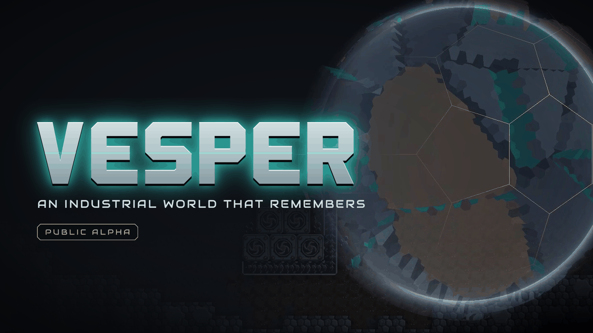
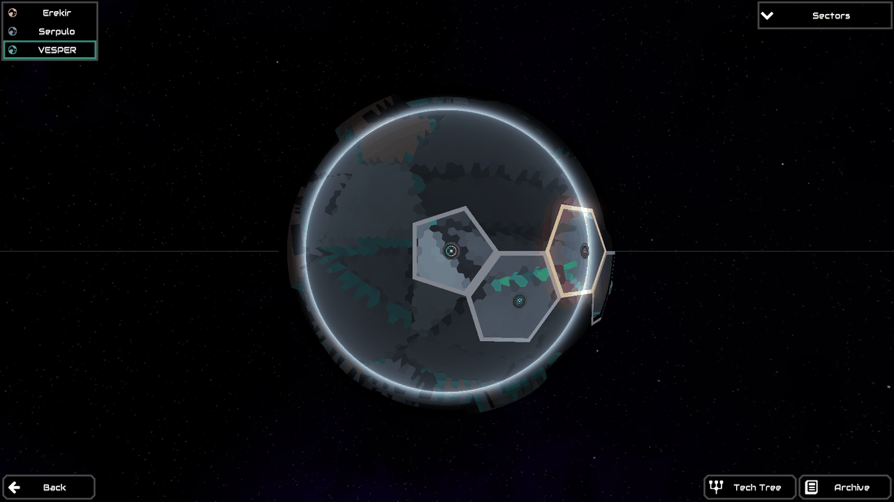
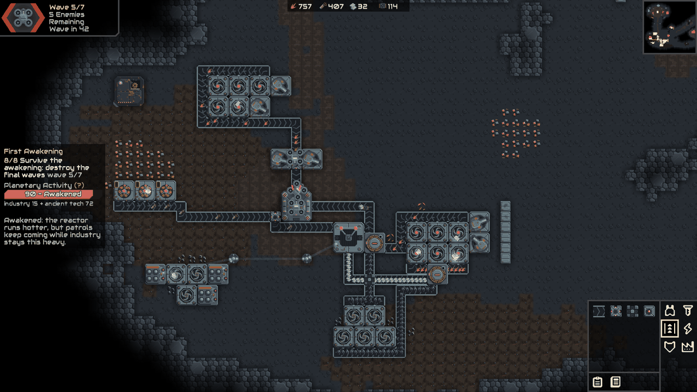
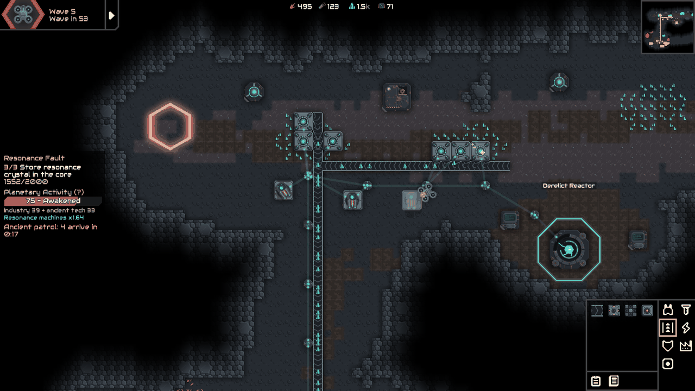
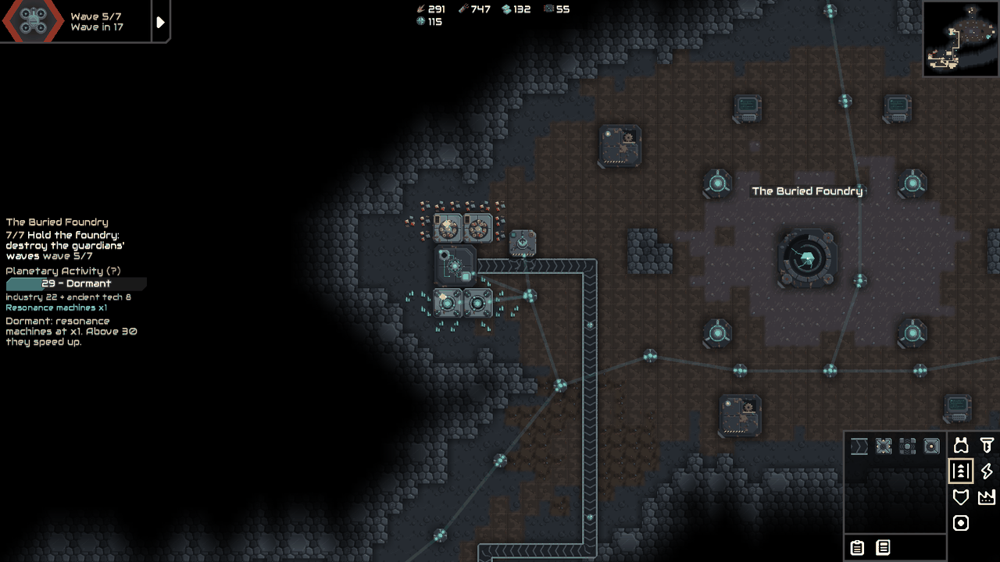
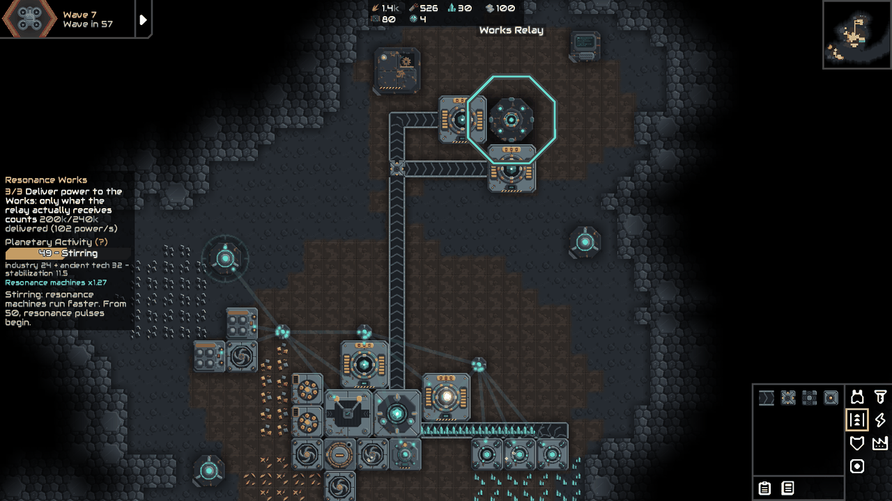
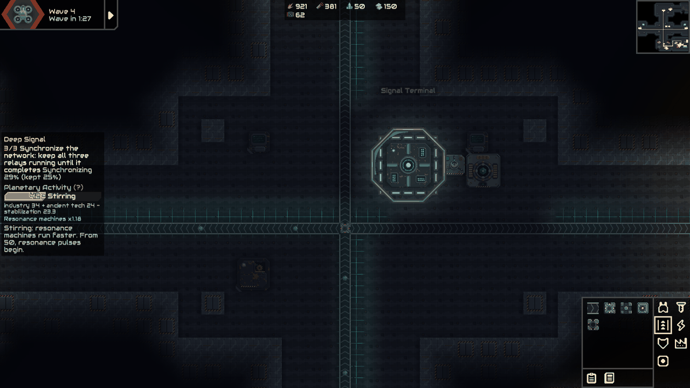
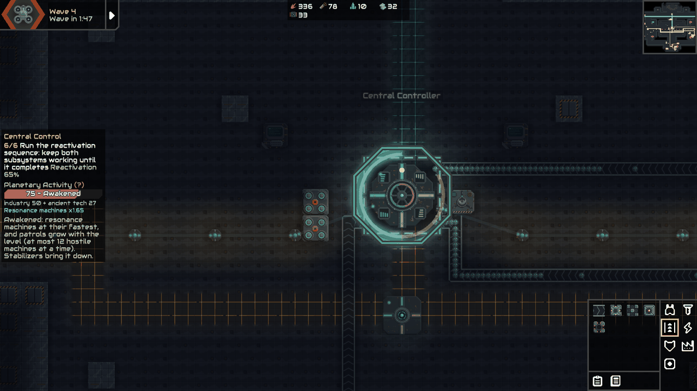
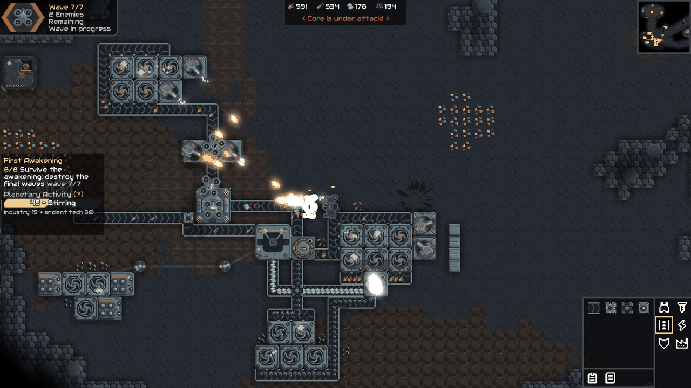

  

  <b>Explore an abandoned machine-planet. Recover its lost industry. Discover what happens when it begins to wake up.</b>

  
  
  
  

VESPER is a campaign and content mod for [Mindustry](https://github.com/Anuken/Mindustry). It adds its own planet, tech tree, industry and ancient machinery, and a planetary response that reacts to the factory you build.

> [!NOTE]
> **VESPER is a public alpha.** Five campaign sectors are playable. **Chapter One is complete. Chapter Two has begun and is not complete.** Balance, presentation and content may change between versions.

## The campaign

The native campaign takes you down through five sectors, each built around its own idea.

| | Sector | What you do there |
|---|---|---|
| **Chapter One** | **First Awakening** | Build a foothold in a dead valley and reignite a derelict reactor. The basin answers. |
| *The Silent Basin* | **Resonance Fault** | Mine a fault of resonance crystal, and decide how hard to push the planet to get it. |
| | **The Buried Foundry** | Survey an excavated foundry, then restore its machines or strip them for parts. |
| **Chapter Two** | **Deep Signal** | Keep three relays of an underground network running through a synchronization. |
| *The Underworks* | **Central Control** | Split your power grid between two ancient protocols and reactivate the complex. |

**Resonance Works** is a separate scenario about power, containment and risk, under *Play > Custom Game*.

<table>
  <tr>
    <td></td>
    <td></td>
  </tr>
  <tr>
    <td></td>
    <td></td>
  </tr>
  <tr>
    <td></td>
    <td></td>
  </tr>
</table>

## What makes it different

**The planet reacts.** Your industry raises the planet's activity. Past certain levels, resonance machines run faster, announced pulses disrupt nearby production, and ancient machines climb out of the vents. You can stabilize the basin, shield what matters, or push harder and pay for it in defense.

**Industrial archaeology.** Old installations are everywhere. Survey them, then decide what each is worth: a working machine, or salvage. Recovered records slowly reveal what these facilities were doing.

**Resonance industry.** Extract crystal, press resonance cores and burn them in dynamos that follow your power demand. Containment fields hold the pulses back, for a price.

## Installation

**From GitHub**

1. Download `Vesper.jar` from the [latest release](https://github.com/Jovinull/VESPER/releases/latest).
2. In Mindustry, open **Mods** and import the file.
3. Restart the game, open **Play > Campaign** and select the VESPER planet.

Keep only one copy of the mod installed. Mindustry loads a single mod with a given name.

## Compatibility

| | |
|---|---|
| **Game** | Mindustry v160.7 |
| **Languages** | English, Brazilian Portuguese |
| **Multiplayer** | Checked in automated client and server sessions; everyone needs the same version |
| **Android** | Packaged, but not yet run on a device |

## Alpha status

The story stops partway through Chapter Two, and there is no custom music or sound yet. Balance comes from long automated playthroughs, with almost no human testing so far, so your feedback matters.

## Feedback

Found a bug or have an idea? [Open an issue](https://github.com/Jovinull/VESPER/issues). The most useful reports say which sector you were in, what you expected and what happened. A screenshot or save file helps.

## Building from source

You need JDK 17. `./gradlew jar` builds a desktop jar. `./gradlew deploy` builds the universal jar and needs an Android SDK. `./gradlew runServer -Pharness=all` runs the automated test suites on the official dedicated server.

## License

VESPER is free software under the [GNU General Public License v3.0](LICENSE), created by Jovinull.

Its code, maps and art are original to this project. The sprites are generated by the scripts in [`tools/spritegen`](tools/spritegen). VESPER is a fan-made mod for Mindustry, by Anuke, and is not affiliated with its developers.
